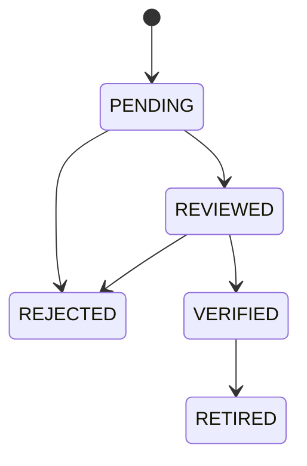

# Product specifications, GTİP and supplier aliases — PR-01B

Implemented 21 October 2026. This extends the new PR-01/02 baseline and existing
catalogue. There are no real classification, supplier or stock records seeded.
PR-01C [product UX and the combined release gate](product-ux.md) are implemented.
PR-02A warehouse/pool metadata is next.

## Specifications and stock identity

Specification definitions have a scoped unique code, name, data type (TEXT,
DECIMAL, BOOLEAN), unit label and `definesStock` flag. Code/type/unit/identity
choice are fixed at creation. Name and active state can change. TEXT values are
trimmed and limited to 1,000 characters; DECIMAL values are exact strings with up
to 14 integer and six fractional digits (optional minus); BOOLEAN uses JSON
true/false. A unit label is descriptive, not a conversion factor.

Values are unique per SKU/definition. The first stock-defining value is fixed:
different goods require another SKU. A descriptive value may be replaced, with
before/after audit. Inactive definitions remain readable but cannot receive new
values. Active SKU and definition are required for mutations. Specifications
do not automatically merge SKUs or generate inventory.

## GTİP history and review

Codes are strings of exactly 12 ASCII digits, retaining leading zeroes. This is
format validation, not confirmation of a valid code or the correct classification.
The [Ministry of Trade tariff FAQ](https://ticaret.gov.tr/gumruk-islemleri/sikca-sorulan-sorular/ticari/tarife)
describes the 12-digit GTİP structure. No tariff rates, statutory classification
decisions or broker-credential checks are implemented by this release.

Each entry retains SKU, code, inclusive effective-from/to dates, source reference,
creator, review and verification actors/timestamps. A null end is open-ended.
Pending/reviewed/verified ranges cannot overlap for the **same SKU**, including
a shared endpoint. Different SKUs may share the same GTİP without being merged.

Every transition needs `products.review` and a reason. VERIFIED additionally
requires broker name, verification reference and verification date. These record
external verification evidence supplied by the authorized reviewer; the app does
not contact or authenticate that broker. The logged-in app actor is recorded
separately. This foundation permits an authorized administrator to review their
own proposal; separate-person approval is not implied by the review permission.

Code, source and start date are not edited in place. To change a valid code from
a later date, use **Set end date** on its VERIFIED entry, then add the next range
beginning the following day. This operation may only shorten the old range and
audits the original/new dates and reason. Historical applicability is retained.
Retirement withdraws an erroneous verified entry from use for **all dates**;
it is not normal expiration. Rejected/retired entries stay visible and a new
proposal can replace them. Each proposal receives a new ID.

The date resolver returns only a VERIFIED entry for an active SKU; gaps yield
null and ambiguity fails closed. There is no fallback to a pending or similar
classification. Supplied dates use the app's existing 1900–2199 date contract.

## Supplier identity and alias revisions

`product_suppliers` is a minimal entity-scoped catalogue reference (code, name,
active), not a payable/accounting supplier master. Purchasing must extend or
explicitly link this identity later; never merge suppliers just by display name.
No tax ID, bank details or opening balance are inferred here.

`product_alias_sources` retains supplier ID, original supplier item code and
original description. The original strings, including case, spaces and line
breaks, are preserved. Code may be empty; description must contain text.
Identity is scoped supplier plus SHA-256 of the exact JSON pair of original
code/description; matching also compares the retained strings. Different spelling
or whitespace requires its own review. There is no fuzzy matching fallback.

`product_aliases` records numbered revisions of a source-to-SKU proposal. Original
source and candidate of each revision stay fixed. The review states above apply;
alias verification needs a reason, while its source reference is supplied when
proposed. Authenticated review and verification actors/timestamps are recorded.

One source may have only one PENDING/REVIEWED/VERIFIED revision. A nullable
`current_source_id`, scoped unique index and status CHECK enforce that even in
SQL. Rejection/retirement releases the source for a new proposal; earlier
revisions retain the earlier candidate, verification and original wording.
Supplier deactivation requires rejecting/retiring current mappings first.

Automatic lookup requires the exact supplier + original code + original
description and returns only a VERIFIED current revision with an active supplier
and active SKU. Inactive, pending, reviewed, rejected or retired records never
match. GTİP, VAT rate, country and text similarity are not lookup criteria.
Changing a stock identity cannot be accomplished by silently rewriting an alias.

## API and permissions

All routes are under `/api/v1/entities/:entityId/products`. Services validate
tenant/entity assignment independently of the frontend. Reads require
`products.read`; proposals, references and values require `products.manage`;
reviews/end-date changes require new `products.review`. Audit retains its separate
`products.audit.read` permission. All also require `workspace.read`. m005 grants
review only to existing ADMIN roles within their existing entity assignments.

| Path | Operations |
|---|---|
| `/suppliers`, `/attribute-definitions` | GET paginated list, POST create |
| Same collections plus `/:id` | GET, PATCH name/active |
| `/skus/:id/attributes` | GET paginated values, POST set value |
| `/skus/:id/gtip-history` | GET paginated history, POST proposal |
| `/skus/:id/gtip-at-date?on=YYYY-MM-DD` | GET verified effective entry or null |
| `/gtip-history/:id` | GET record |
| `/gtip-history/:id/review`, `/gtip-history/:id/end-date` | POST reviewed transitions/date change |
| `/aliases`, `/aliases/:id` | GET lists/record; POST proposal to collection |
| `/aliases/:id/review` | POST transition |
| `/alias-matches` | Read-only POST exact match check, result or null |

Writes require signed session-bound CSRF, allowed Origin, JSON and Idempotency-Key.
The read-only match POST uses CSRF/Origin/JSON without requiring an idempotency
key, keeping supplier descriptions out of query URLs. No editing/deleting history
routes exist. Lists use default 25/max 100 rows and stable ordering. References
filter by code/name and active status; aliases by original code/description or SKU
code, status, supplier ID and SKU ID; GTİP history by status.

Entity locking, permission recheck, domain changes, append-only audit and saved
idempotent response share one transaction. Overlap/duplicate checks execute under
that lock; composite FKs prohibit cross-entity references. Audit failure rolls
back new source rows, values, review transitions and retry response together.
Review changes use `product.*` audit actions and cannot be read via accounting
audit permission. Code/name/date/status facts are readable with products.read;
the detailed before/after action log requires product audit permission.

## Schema and UI

m005 adds six tables: supplier references, attribute definitions, SKU values,
GTİP history, original alias sources and alias revisions. Total schema: 29 tables.
m001–m004 stay immutable. The migration seeds permission definitions/grants only.

Products now includes Specification definitions, Suppliers and Supplier aliases.
Use a SKU's **Details** button for its specifications and GTİP history. Review
controls follow the permission and current state. The supplier match form exposes
positive/negative exact matches; refresh/edit hides stale match results. Tables
scroll on mobile; navigation stays in the sidebar without a global header.

PR-01C adds persistent views, family/alias SKU drill-down, supplier/SKU filters,
shared validation and the product release gate. Inventory, invoice import,
automatic tax calculations and legacy workbook data remain outside PR-01.
