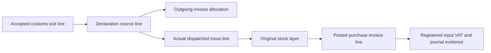

# Input VAT sources and accepted-export attribution

PR-05A, 27 October 2026 (Europe/Istanbul). Runtime migration:
`m017_vat_source_attribution`. Applied m001–m016 remain unchanged.

## Original purchase facts

VAT → Input VAT sources registers selected POSTED PR-03C receipt lines. Registration
requires the exact original invoice line, posted stock receipt and original layer.
Positive deductible VAT must match its actual posted VAT journal line, account and
amount. All-free receipts may have no journal. A second identical registration
returns the existing source; it never creates a duplicate VAT basis.

The immutable source keeps invoice XML hash/UUID, supplier, line key, SKU, original
quantity, source currency/VAT, dated FX rate and evidence, base currency, converted
VAT, deductible VAT, capitalized VAT, original inventory value, stock layer and
journal references. None of these amounts is inferred from current stock cost.
DEDUCTIBLE, CAPITALIZE and NONE retain the purchase receipt's explicit treatment.
Zero VAT and free goods remain zero; registration creates no additional journal.

## Exact export lineage

An attribution selects quantities from one independently APPROVED CLEARANCE:

The service follows retained IDs rather than selecting an alternative purchase.
Fixture/opening/unsupported layers and missing purchase registration are explicit
blockers. A declaration, reservation, dispatch or invoice alone is insufficient.
Approval revalidates immutable provenance and the original context hash. Later
catalogue names/activity, current stock value or a new final-closure record do not
replace original evidence. SKU base unit and precision are immutable catalogue facts.

## Quantities, money and decisions

- Each selected quantity is positive, respects the original SKU precision and fits
  both its accepted exit quantity and its remaining original purchase quantity.
- REQUESTED, APPROVED and VOID_REQUESTED reserve quantities and all four VAT amounts.
  HOLD and EXCLUDED also reserve their basis, preventing a second candidate for the
  same goods. Only APPROVED/VOID_REQUESTED contribute to accepted candidate totals.
- CANDIDATE requires explicit treatment evidence. It attributes original deductible
  VAT only. HOLD and EXCLUDED have zero candidate VAT while preserving factual amounts.
  Capitalized VAT is retained separately and never becomes deductible candidate VAT.
- TEMPORARY_EXPORT and RETURN_EXPORT must remain HOLD/EXCLUDED until dedicated
  treatment exists. An outgoing line with nonzero source VAT must remain HOLD/EXCLUDED.
  STANDARD_EXPORT and FREE_OF_CHARGE are eligible for explicit analytical review,
  not automatically eligible for a refund. Original outgoing VAT/profile is retained.
- Each amount uses original VAT × selected quantity / original quantity, rounded
  half-up to six decimals with high precision. Non-final allocation is capped at the
  available remainder; the final source quantity takes the exact residual.
  Cancellation, rejection or accepted void releases its exact recorded reservations.
  Approval keeps recorded amounts; it does not reround them after another request changes.
- Native VAT totals are grouped by currency. One attribution has one base currency;
  different base currencies require separate requests. Quantity totals are trace
  totals, not an interchangeable unit across different SKUs.
- Preview is a read-only snapshot. Request rebuilds balances under the entity lock.
  Concurrent overlapping requests cannot exceed source or accepted exit quantities.

The requester cannot approve or reject their own attribution. An approved record
can request void with reason/evidence. A different authorized person accepts or
rejects that void. While pending, the original quantities and candidate totals remain
committed. Accepted void releases only analytical attribution. Original source,
lines, approval and every correction decision remain immutable. Decisions have a
per-attribution sequence, so actions within the same timestamp retain their order. A corrected request
uses a new reference. No stock/GL/customs reversal is inferred.

## Database, API and UI

Four scoped tables bring the runtime schema to 94 tables / 17 migrations:
`vat_input_sources`, `vat_attributions`, `vat_attribution_lines`,
`vat_attribution_decisions`. m017 adds a scoped unique index to existing
`journal_lines` for its composite source FK. Existing journal rows are unchanged.
Composite FKs, immutable rows, unique source/layer/reference keys, amount checks,
entity-lock triggers, allowed state transitions, independent review and source/exit
commitment guards supplement service validation. Explicit migration verification
checks columns, indexes, FKs, checks and complete trigger bodies; rerun and recovery
preserve earlier migration checksums and history.

New ADMIN permissions: `vat.source.register`, `vat.attribution.request`,
`vat.attribution.review`, `vat.audit.read`; existing `vat.read` permits scoped reads.
Routes live under `/api/v1/entities/:entityId/vat`. Session, assigned-entity permission,
JSON, allowed Origin and CSRF apply; mutations additionally require Idempotency-Key.
Registration/request/review, audit and retry result commit together. Failed audit
rolls back the state and reservations. OpenAPI 0.18.0 documents all routes.

The lazy-loaded VAT screen has Input VAT sources, Export attributions and authorized
Audit trail views. Source selection and exit selection persist across pages; preview
shows source amounts before requesting review. Details retain journal/stock/customs
evidence, decisions and correction history. URLs/reload, reader controls, keyboard
tabs and mobile widths follow the sidebar-only application layout.

There is no fixed business line-count ceiling. Requests retain the existing 1 MiB
JSON guard, atomic writes use 250-row batches, reads return at most 100 rows and UI
tables show 25. Preview and request process the selected complete source set; they
are not claims of unlimited memory or production throughput. The regression suite
includes 301-line exports with split original layers and exact source balances.

## Scope and next stage

No real invoice enrollment, historical stock/VAT import, new local reviewer,
account changes, tax-period deduction, refund entitlement, claim or external
transmission is performed. Actual local invoices remain staged until the user
undertakes their existing purchasing review/receipt workflow.

PR-05B now adds separately evidenced directly linked charges, overhead and ATİK
allocation with explicit reviewed bases. Its active monthly basis freezes candidate
goods transitions; release allocations and independently void that basis before
correcting goods. See [the allocation contract](vat-cost-allocation.md). Original
VAT and capitalized cost remain separate, with duplicate-source guards. PR-06A now reconciles deduction/tax periods and reviewed refund eligibility, and prevents voiding claimed amounts without coordinated claim correction. See [the reconciliation contract](vat-refund-reconciliation.md). Future purchase returns/financial reversals must similarly guard
VAT dependencies before releasing source quantities.

The distinction between source attribution and subsequent refund determination is
consistent with GİB's [common VAT refund rules, IV/A.3](https://cdn.gib.gov.tr/api/gibportal-file/file/getFileResources?objectKey=arsiv%2Fyardim-kaynaklar%2Fyararli-bilgiler%2Fkdv-iadesinde-ortak-husular.pdf)
and [VAT General Application Communiqué](https://cdn.gib.gov.tr/api/gibportal-file/file/getFile?objectKey=MEVZUAT_TEBLIGLER%2FUNIVERSAL%2F2026%2Fkdv_genteb.pdf),
consulted for this stage. Those references do not turn local review into legal
certification. No manufacturer-specific percentage method or legal refund cap is
automatically applied to this trading-exporter workflow.
